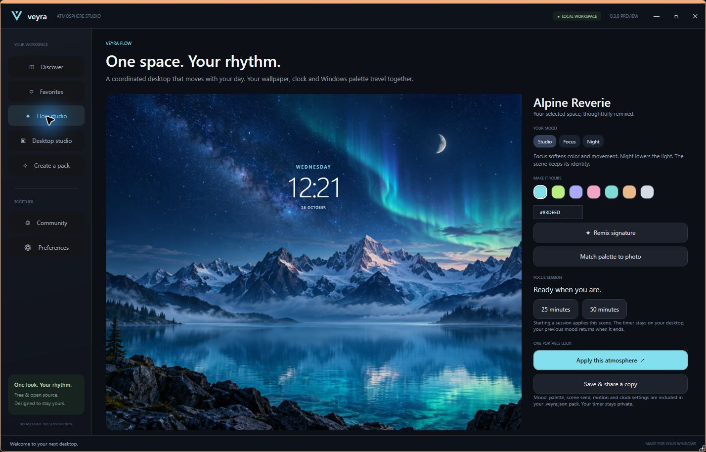

# Veyra Desktop Studio

**One look. Your rhythm.**

A free, open-source atmosphere studio for Windows. Pick a GPU scene, coordinate your desktop clock and Windows palette, then move between Studio, Focus and Night. Save the look as one portable `.veyra.json` file.

[Discord community](https://discord.gg/wuZSKphzmP) · [Creator guide](docs/CREATOR-GUIDE.md) · [Release notes](docs/RELEASE-NOTES.md)



## Public preview 0.3.0

Source repository: [taj2332/veyra-desktop-studio](https://github.com/taj2332/veyra-desktop-studio). The portable preview is prepared locally; a public GitHub Release download is still pending. Build from source or use the Windows workflow artifact when available.

1. Close older Veyra copies through their tray menu.
2. Extract the entire portable ZIP to a writable folder. Keep all DLLs and `Veyra.exe.config` beside the EXE.
3. Open **Veyra.exe**, choose a scene and select **Apply desktop**.
4. Open **Flow studio** to choose a mood, start a focus session, sample a photo palette or remix a signature.
5. Close the studio to keep the desktop running in the tray. Reopening Veyra returns to the existing instance. After a full quit, the next launch resumes the saved atmosphere if it was left active.
6. Use **Preferences → Restore saved desktop** to restore captured static wallpaper and appearance settings.

Requires Windows x64, .NET Framework 4.8 and the Microsoft WebView2 Evergreen Runtime. Windows 11 normally includes the Runtime; Preferences links to Microsoft's download page if it is missing. No account, subscription or hosted service is required for the local scenes.

## What makes Veyra useful

**Veyra Flow** treats a wallpaper, clock, palette and mood as one shareable atmosphere. Studio preserves the original look, Focus reduces color and motion, and Night lowers the light. A 25- or 50-minute focus session places a countdown beside the desktop clock and restores the previous mood when it ends. The countdown stays private and is not exported.

**Signature remixes** change a procedural seed and coordinated accent. **Photo palette matching** samples a dominant saturated color from a built-in or imported photo. These are a focused product direction, not a claim that no other wallpaper application has similar capabilities.

## Included

- 16 original scenes rendered through WebGL: Alpine Reverie, After Hours, Liquid Silk, Aurora, Dune, Orbit, Bloom, Tide, Summit, Ember, Deep Space, Rain Room, Woodland, Monochrome, Sakura and Lagoon.
- Original procedural light fields, liquid ribbons, layered landscapes, a shaded planet, rain, snow and fireflies. Photo scenes use gentle camera motion and optional atmosphere effects.
- Editorial, Digital and Minimal clocks with size and position controls.
- Native Windows taskbar accent, light/dark appearance, Windows transparency, auto-hide and desktop-icon visibility. No extra dock. Windows taskbar accent color requires dark system mode.
- Import/export, image packs, favorites, creator attribution and a local library.
- Balanced and Ultra rendering, 15/30/60 FPS targets, battery/fullscreen pause and live FPS readout.
- Actual desktop inspection through Preferences → Desktop monitor, using Explorer's DWM surface.

## Performance and limits

On the development PC (Windows build 26300, GTX 1650, one 1920×1080 display), the animation loop reached about 60 FPS with a 16.8 ms p95 interval. A controlled legacy raster/copy benchmark reached about 22 FPS. These are local render-loop measurements, not a guarantee of monitor presentation timing or performance on other hardware. The WebView2 browser processes use additional memory.

Ultra uses native viewport resolution. Balanced reduces the shader resolution while keeping HTML clock text sharp. Procedural scenes scale without a fixed artwork resolution. Raster artwork keeps its source detail: the two supplied photos are 1672×941, not native 4K imagery.

Virtual 4K, ultrawide and portrait viewports were checked. Multiple physical monitors, mixed DPI, HDR and sleep/resume still need broader testing. Explorer hosting uses undocumented shell behavior. This release remains a preview, is unsigned and has no automatic startup or auto-update service.

Video-file wallpapers, audio-reactive rendering, arbitrary native taskbar skins/icon replacement and a hosted submission gallery are not implemented. Pack files cannot contain scripts or arbitrary web pages. Recovery restores captured static assignments and changed appearance settings, not Spotlight/slideshow scheduling or another wallpaper application's process state.

## Build

```powershell
.\build.ps1
.\build.ps1 -Test
```

Uses the .NET Framework C# compiler supplied with Windows. No .NET SDK, npm or NuGet restore is required: the pinned Microsoft WebView2 SDK assemblies are included in `vendor/webview2/` with their license and notice. See [dependencies](docs/DEPENDENCIES.md).

The read-only GitHub workflow compiles, runs non-destructive checks and uploads a build artifact. Native/GPU integration tests require an interactive Windows desktop and are documented in [validation](docs/VALIDATION.md).

## Update from 0.2

Close the older app, then copy its `VeyraData` folder beside the new EXE to retain the library, favorites and original-desktop backup. Older packs import with Flow defaults. Retired dock settings are ignored. Browser caches live only inside the local data folder and are excluded from release/source ZIPs.

## Community and licenses

Join [Veyra on Discord](https://discord.gg/wuZSKphzmP) for setups, recipes, development feedback and help. Core functionality has no payment gate. Optional donation links are unconfigured until the maintainer supplies one.

Application and shader code: MIT. Original procedural rendered artwork: CC0-1.0. Generated raster assets and branding: see ARTWORK.md. Microsoft WebView2 SDK redistribution retains Microsoft's BSD-style license and notice; the separately installed Runtime has Microsoft's own terms.
